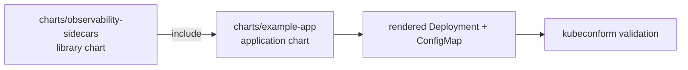

# 14-helm-observability-sidecar-library

Every team that bolts on metrics and log shipping by hand ends up with a
slightly different sidecar in every chart: different images, different
security contexts, a few charts that forgot `readOnlyRootFilesystem`
entirely. This repo is a Helm **library chart** that defines the sidecar
containers, volumes and security context once, so any consumer chart can
pull them in with a handful of `include` calls instead of copy-pasting
YAML.

Scope: this chart injects a **StatsD-to-Prometheus exporter** sidecar
(`prom/statsd-exporter`, port 9102) and a Fluent Bit sidecar that tails a
shared log volume and ships to stdout. The exporter sidecar listens for
StatsD-protocol metrics and re-exposes them in Prometheus format on
`/metrics` for a Prometheus server to scrape - it does not run Prometheus
itself, and it does not scrape or instrument the app on its own; the app
has to emit StatsD metrics for there to be anything on that endpoint. This
chart wires the sidecar up but does not send it any metrics itself. There
is no real log backend, no Prometheus Operator CRDs (no
ServiceMonitor/PodMonitor), and nothing here is deployed to a cluster - it
is validated with `helm lint`, `helm template` and `kubeconform` only.

## Architecture



- `charts/observability-sidecars` - type `library`. Named templates only,
  no rendered resources: sidecar container specs, pod/container
  `securityContext` defaults, shared volumes, and a Fluent Bit config
  snippet.
- `charts/example-app` - type `application`. Depends on the library chart
  via a local `file://` path and includes its templates in a real
  Deployment and ConfigMap, to show how a consumer chart would use it.

## Prerequisites

- Tested with Helm v3.16.2
- [kubeconform](https://github.com/yannh/kubeconform) (CI only; optional
  locally)
- No Kubernetes cluster required

## Usage

A consumer chart adds the library as a dependency:

```yaml
# Chart.yaml
dependencies:
  - name: observability-sidecars
    version: "0.1.0"
    repository: "file://../observability-sidecars"
```

and nests its sidecar configuration under `observabilitySidecars` in its
own `values.yaml` (see `charts/example-app/values.yaml` for the full
shape). Then, in a Deployment template:

```yaml
spec:
  template:
    spec:
      securityContext:
        {{- include "observability-sidecars.podSecurityContext" . | nindent 8 }}
      containers:
        - name: app
          securityContext:
            {{- include "observability-sidecars.containerSecurityContext" . | nindent 12 }}
          volumeMounts:
            - name: varlog
              mountPath: /var/log/app
        {{- include "observability-sidecars.sidecars" . | nindent 8 }}
      volumes:
        {{- include "observability-sidecars.volumes" . | nindent 8 }}
```

## Examples

```sh
helm dependency update charts/example-app
helm lint charts/observability-sidecars
helm lint charts/example-app

# both sidecars enabled (default)
helm template charts/example-app

# opt out of both sidecars
helm template charts/example-app -f charts/example-app/values-minimal.yaml
```

Toggle each sidecar independently:

```yaml
observabilitySidecars:
  prometheus:
    enabled: false
  fluentbit:
    enabled: true
```

## Security considerations

- Pod and container security contexts default to the restricted baseline:
  non-root, all capabilities dropped, no privilege escalation, read-only
  root filesystem, and the `RuntimeDefault` seccomp profile. This applies
  to the app container and both sidecars equally.
- The Fluent Bit sidecar only mounts the shared log volume read-only; it
  never gets write access to the app's filesystem.
- No credentials or endpoints are baked in anywhere - Fluent Bit ships to
  stdout, and the statsd-exporter sidecar only exposes a scrape port; it
  receives no real traffic in this chart.

## Idempotency

`helm template` and `helm install --dry-run` are pure functions of the
chart and values - running them repeatedly against the same inputs
produces identical output. The library chart defines no resources of its
own, so it cannot create or mutate cluster state; only the consumer
chart's `helm upgrade --install` does, and that is a standard Helm
upgrade (safe to re-run).

## Known limits

- No ServiceMonitor/PodMonitor templates - those need the Prometheus
  Operator installed, which is out of scope for a chart that should
  lint/template without a cluster.
- No NetworkPolicy - out of scope for sidecar injection and security
  contexts.
- Only validated with `helm lint`/`helm template`, `kubeconform` and a
  rendered-output test script. Never deployed to a real cluster.
- Nothing in this chart or its tests sends StatsD metrics to the exporter
  sidecar - the container is wired up correctly, but there is no exercised
  end-to-end metrics pipeline.
